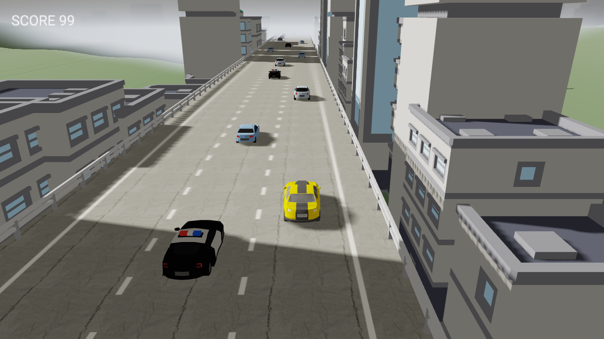

<div align="center">

# KamanEngine

**A Rust game engine for Apple platforms, rendering with raw Metal.**

[](https://github.com/parsabee/KamanEngine/actions/workflows/ci.yml)
[](https://github.com/parsabee/KamanEngine/actions/workflows/docs.yml)
[](https://parsabee.github.io/KamanEngine/)
[](https://github.com/parsabee/KamanEngine/releases)
[](#project-status)
<br>
[](LICENSE)
[](rust-toolchain.toml)
[-lightgrey?logo=apple)](#prerequisites)
[](docs/ARCHITECTURE.md)

[Quick start](#quick-start) ·
[Playable demo](#the-playable-demo) ·
[Documentation](#documentation) ·
[Roadmap](docs/ROADMAP.md) ·
[Contributing](#contributing)



<sub>The playable demo, rendered offscreen by the engine's Metal backend at 1280×720.</sub>

</div>

---

KamanEngine is a Cargo workspace of focused `kaman-*` crates for building games on **macOS and
iPhone**. Because both platforms use Metal natively, raw Metal is *one* code path, not two, and a
backend-agnostic render seam keeps the door open for a future portable backend without touching
engine logic.

The engine is **rasterization-only**. For v0.1 it is becoming a lean graphics library with a C
API, so that any host app (C, C++, Swift) can drive it; see the [roadmap](docs/ROADMAP.md). Its
reference title is the [playable demo](#the-playable-demo), an endless car runner on a freeway.

> [!NOTE]
> KamanEngine is **pre-release and under active development**. The current release is
> [`v0.1.0-beta.1`](https://github.com/parsabee/KamanEngine/releases/tag/v0.1.0-beta.1), a beta:
> each release ships a prebuilt Apple Silicon build (the C library, its header and the playable
> demo), installable with [Homebrew](#install-with-homebrew). The public API may change between
> releases (see [CHANGELOG.md](CHANGELOG.md)). macOS is the supported platform today; iOS support
> is planned for v0.2 ([#2](https://github.com/parsabee/KamanEngine/issues/2)).

## Table of contents

- [Features](#features)
- [Install with Homebrew](#install-with-homebrew)
- [Quick start](#quick-start)
- [Using KamanEngine from C or Swift](#using-kamanengine-from-c-or-swift)
- [The playable demo](#the-playable-demo)
- [Project status](#project-status)
- [Documentation](#documentation)
- [Workspace layout](#workspace-layout)
- [Contributing](#contributing)
- [License](#license)

## Features

- **A C API** (`libkaman` + a generated `kaman.h`, with a Swift module map) for hosts in C,
  Objective-C, Swift or C++. It is asynchronous in shape: calls return at once with a handle or a
  result code, resources become ready later, and completions arrive as events. glTF models load
  on worker threads, and acquiring a frame never waits. See [docs/C_API.md](docs/C_API.md).
- **Raw Metal behind a render seam.** `kaman-render-api` defines the render contract
  (`RenderDevice` / `FrameRecorder` traits and opaque handles). `kaman-render` is the only crate
  that depends on `metal`, and CI fails if the seam crate ever gains a `metal` dependency.
- **ECS** built on [`hecs`](https://crates.io/crates/hecs), with a shared vocabulary of engine
  components.
- **Physics** via [`rapier3d`](https://rapier.rs), stepped in lockstep with the simulation.
- **Fixed-timestep game loop** with a clean `Game` / `EngineCtx` boundary. The same loop drives
  both the windowed app and a headless driver.
- **World streaming** (spawn-ahead / despawn-behind) and a **floating-origin rebase** for endless
  worlds.
- **Asset import:** static glTF (`.gltf` / `.glb`) meshes and textures, uploaded once and
  referenced by handle.
- **A modern look stack:** MSAA, a gradient sky with a drivable sun disc, specular lighting,
  ground-hugging horizon fog, ACES tonemapping, and **real fitted shadow maps** with PCF filtering.
- **2D HUD overlay** with SDF text rendering.
- **Audio** built on [`kira`](https://crates.io/crates/kira): load-once sounds, one-shots, looping
  music, and master volume.
- **Testable by design:** a headless smoke oracle that runs with no GPU, golden pixel-hash tests
  that pin the renderer's output, a null backend that runs the C API without a GPU, and a C
  program compiled and run against the header in CI.
- **Fully documented API:** every engine crate compiles under `#![deny(missing_docs)]`, and the
  rustdoc is [published online](https://parsabee.github.io/KamanEngine/).

## Install with Homebrew

On an **Apple Silicon** Mac (arm64; Intel Macs are not supported and Homebrew refuses the
install), install the prebuilt demo, the C library and the engine source, with no Rust toolchain
needed:

```sh
brew install parsabee/kaman/kaman-engine
kaman-demo            # play the demo (Metal window)
kaman-demo --smoke    # headless check: 120 frames, prints "smoke: 120 frames OK"
```

What gets installed:

| Path | Contents |
|---|---|
| `$(brew --prefix)/bin/kaman-demo` | The playable demo (the `playable-demo` binary) |
| `$(brew --prefix)/lib/libkaman.a`, `libkaman.dylib` | The C library, static and dynamic (install name `@rpath/libkaman.dylib`) |
| `$(brew --prefix)/include/kaman/` | `kaman.h` and the Swift `module.modulemap` |
| `$(brew --prefix)/lib/pkgconfig/kaman.pc` | `pkg-config --cflags --libs kaman` |
| `$(brew --prefix kaman-engine)/share/kaman-engine/assets/` | The demo's runtime assets |
| `$(brew --prefix kaman-engine)/share/kaman-engine/src/` | The engine source: the workspace `Cargo.toml` / `Cargo.lock` / `rust-toolchain.toml`, `crates/`, `games/`, `docs/`, `LICENSE`, `NOTICE` |

To build your own game against the installed engine, use the crates as Cargo path dependencies
(building needs Rust 1.91 or newer):

```toml
[dependencies]
kaman-core = { path = "/opt/homebrew/opt/kaman-engine/share/kaman-engine/src/crates/kaman-core" }
kaman-math = { path = "/opt/homebrew/opt/kaman-engine/share/kaman-engine/src/crates/kaman-math" }
```

`brew info kaman-engine` prints these paths for your prefix. The tarball Homebrew downloads is
attached to each [GitHub release](https://github.com/parsabee/KamanEngine/releases) as
`kaman-engine-<version>-aarch64-apple-darwin.tar.gz`, with a `.sha256`; it is built by
[`.github/workflows/release.yml`](.github/workflows/release.yml) via
[`scripts/package-release.sh`](scripts/package-release.sh), and the formula lives in
[`packaging/homebrew/kaman-engine.rb`](packaging/homebrew/kaman-engine.rb).

## Quick start

### Prerequisites

KamanEngine is **Apple-only** (macOS today, iOS planned). Check your toolchain before building:

```sh
./scripts/preflight.sh          # deps needed to build the engine today
./scripts/preflight.sh --ios    # also require the iOS + precompiled .metallib toolchain
```

There are two tiers of dependencies:

| Tier | Tools | Needed for |
|---|---|---|
| **Required now** | macOS · Rust ≥ 1.91 (`cargo`/`rustc`, MSRV enforced by cargo) · Apple `clang` + macOS SDK (Command Line Tools) | Building and running the engine on macOS |
| **iOS / `.metallib`** | Full **Xcode** (`metal`/`metallib` shader compiler) · `rustup` + `aarch64-apple-ios`(`-sim`) targets | Precompiled `.metallib` shaders (planned for v0.1.0) and iOS builds (v0.2) |

The Command Line Tools alone (`xcode-select --install`) cover the engine today, because shaders
currently compile at runtime. Full Xcode becomes required once shaders are precompiled (v0.1.0)
and for iOS (v0.2). The iOS targets are not needed yet:

```sh
rustup target add aarch64-apple-ios aarch64-apple-ios-sim   # iOS (v0.2) only
```

**Toolchain:** `rust-toolchain.toml` pins `1.91.0` (with `rustfmt`, `clippy` and
`rust-analyzer`). rustup (the recommended setup) and CI honour it, and cargo also enforces the MSRV
through `rust-version`.

### Build, run and test

```sh
git clone https://github.com/parsabee/KamanEngine.git
cd KamanEngine

cargo build --workspace
cargo run -p playable-demo                               # the demo, windowed (Metal)
cargo test  --workspace
cargo fmt --all -- --check
cargo clippy --workspace --all-targets -- -D warnings
cargo run -p playable-demo -- --smoke                    # headless oracle: 120 frames, exits 0
./scripts/test-c-api.sh                                  # build libkaman, compile + run the C programs
./scripts/gen-header.sh --check                          # kaman.h matches the Rust sources (needs cbindgen 0.29.0)
```

## Using KamanEngine from C or Swift

Build the library from a checkout (or install it with [Homebrew](#install-with-homebrew)):

```sh
cargo build --release -p kaman-capi
# -> target/release/libkaman.a and target/release/libkaman.dylib
# header and Swift module map: crates/kaman-capi/include/
```

Then include `kaman.h` and link `libkaman`:

```sh
# Installed with Homebrew: pkg-config knows the paths and, with --static, the frameworks.
cc -std=c11 app.c $(pkg-config --cflags --libs kaman) -o app
# From a checkout, linking the static library by hand:
cc -std=c11 app.c -I crates/kaman-capi/include target/release/libkaman.a \
   -framework Metal -framework QuartzCore -framework Foundation -framework CoreGraphics \
   -framework AppKit -framework CoreFoundation -lobjc -liconv -o app
```

The exact library list for static linking is what rustc reports
(`cargo rustc -p kaman-capi --lib --crate-type staticlib -- --print native-static-libs`);
[`scripts/test-c-api.sh`](scripts/test-c-api.sh) builds this way. From Swift, put the include
directory on the import paths (`SWIFT_INCLUDE_PATHS` in Xcode, or `-I`), link `libkaman`, and
`import Kaman`.

A frame looks like this; the full contract (handles, events, threading, what may wait) is
[docs/C_API.md](docs/C_API.md), and [`examples/c/offscreen.c`](examples/c/offscreen.c) is a
complete program:

```c
KamanContextDesc desc = { KAMAN_API_VERSION, KAMAN_BACKEND_METAL, metal_layer, 1280, 720, 2.0f };
KamanContext *ctx;
kaman_context_create(&desc, &ctx);

KamanModel car;
kaman_model_load_file(ctx, "car.glb", NULL, &car);   /* returns at once; loads off-thread */

/* every display tick */
KamanEvent events[16];
uint32_t n;
kaman_poll_events(ctx, events, 16, &n);              /* housekeeping + completions */
KamanFrame *frame;
if (kaman_frame_acquire(ctx, &frame) == KAMAN_OK) {  /* never waits */
    kaman_frame_set_camera(frame, &camera);
    kaman_frame_draw_model(frame, car, &world, NULL); /* KAMAN_NOT_READY until loaded */
    kaman_frame_submit(frame, NULL, NULL);
}
```

## The playable demo

[`games/playable-demo`](games/playable-demo) is the first title, an endless 3-lane freeway runner.
It is also the **reference example** for building a game on this engine: it touches nothing but
the engine's public API.

```sh
cargo run -p playable-demo             # windowed, Metal backend (macOS)
cargo run -p playable-demo -- --smoke  # headless oracle: 120 frames, prints "smoke: 120 frames OK", exits 0
```

| Key | Action |
|---|---|
| `Left` / `Right` | Move one lane left / right (one lane per press) |
| `Space` | Start the run from the title screen; replay after a crash |
| `Escape` | Quit |

Graphics settings (shadows, shadow distance, draw distance, resolution, full screen) are in the
**Graphics** menu in the macOS menu bar, and are remembered between launches.

- [docs/PLAYABLE_DEMO.md](docs/PLAYABLE_DEMO.md): how the demo is built. Covers the
  `Game`/`EngineCtx` boundary, the fixed-timestep loop, streaming + floating-origin rebase, asset
  loading, the render seam, the HUD, and determinism/testing.
- [docs/GETTING_STARTED.md](docs/GETTING_STARTED.md): **build your own game**. The minimal steps
  to stand up a new `Game`, load an asset, record a draw, and run it windowed and headless.
- [games/playable-demo/README.md](games/playable-demo/README.md): the demo's own README, with the
  code layout, the asset bakers, and asset licences.

## Project status

KamanEngine was built by **migrating and refactoring** an earlier prototype into this repo, module
by module, under a test-and-document-as-you-go discipline: nothing was migrated without unit tests
and rustdoc. The prototype's provenance is recorded in [docs/ARCHITECTURE.md](docs/ARCHITECTURE.md).

| Release | State |
|---|---|
| `v0.1.0-alpha.2` | macOS on Apple Silicon: the engine crates, the playable demo, and a Homebrew install |
| `v0.1.0-beta.1` (current) | The async-shaped C API (`libkaman`, `kaman.h`, a Swift module map), sRGB colour textures and correct normals, docs that match the code, and a test and bug-fix pass |
| `v0.1.0` | Planned: precompiled `.metallib` shaders and benchmarking |
| `v0.2` | Planned: iOS ([#2](https://github.com/parsabee/KamanEngine/issues/2)) |

- Roadmap: [docs/ROADMAP.md](docs/ROADMAP.md)
- Open work: [GitHub issues](https://github.com/parsabee/KamanEngine/issues)

## Documentation

**API reference: <https://parsabee.github.io/KamanEngine/>.** It is built from rustdoc and
published to GitHub Pages on every push to `main` (see
[`.github/workflows/docs.yml`](.github/workflows/docs.yml)). CI keeps it free of broken intra-doc
links. To build it locally:

```sh
cargo doc --workspace --no-deps --open
```

Guides and design docs:

| Document | What it covers |
|---|---|
| [docs/GETTING_STARTED.md](docs/GETTING_STARTED.md) | Build your own game on the engine |
| [docs/C_API.md](docs/C_API.md) | The C API: concepts, threading, what may wait in the beta, reference |
| [docs/PLAYABLE_DEMO.md](docs/PLAYABLE_DEMO.md) | The demo walked through as a reference example |
| [docs/DESIGN.md](docs/DESIGN.md) | Diagrams: component, UML class and sequence diagrams (Mermaid) of the layers, the render seam, the frame loop, streaming, and asset load |
| [docs/ARCHITECTURE.md](docs/ARCHITECTURE.md) | Intentional constraints, the render seam, and workspace layout |
| [docs/ROADMAP.md](docs/ROADMAP.md) | What v0.1 and v0.2 contain |
| [docs/INTEGRATION.md](docs/INTEGRATION.md) | Integration, testing and migration discipline |
| [CHANGELOG.md](CHANGELOG.md) | Release history and notable changes |

## Workspace layout

The workspace is `crates/kaman-*` (the engine) plus `games/playable-demo` (the first title and the
smoke oracle). The layout follows [docs/ARCHITECTURE.md](docs/ARCHITECTURE.md) §3.

| Crate | Purpose |
|---|---|
| [`kaman-capi`](crates/kaman-capi) | The C API: `libkaman` (static and dynamic), the generated `kaman.h` and the Swift module map, over a Metal or a null backend. Graphics only: no windowing, audio, ECS or physics |
| [`kaman-core`](crates/kaman-core) | Application lifecycle and the engine/game boundary: the `Game` trait, `EngineCtx`, the fixed-timestep loop, input, and the windowed (winit) and headless drivers |
| [`kaman-render-api`](crates/kaman-render-api) | Backend-agnostic render seam: `RenderDevice` / `FrameRecorder` traits, opaque handles, descriptors, sun/sky and 2D overlay types, and a `NullRenderer` test double. Never depends on `metal` |
| [`kaman-render`](crates/kaman-render) | Raw-Metal implementation of the seam: rasterization pipeline, look stack, shadow maps, offscreen rendering and pixel read-back |
| [`kaman-assets`](crates/kaman-assets) | Static glTF import and asset cache (metal-free) |
| [`kaman-audio`](crates/kaman-audio) | Audio over `kira`: load-once sounds, one-shot playback, looping music, master volume |
| [`kaman-camera`](crates/kaman-camera) | Camera state and controller math (perspective camera, chase controller) |
| [`kaman-ecs`](crates/kaman-ecs) | `hecs` wrapper and the shared engine components |
| [`kaman-math`](crates/kaman-math) | Shared math layer: `glam` re-export plus the `Transform` (TRS) type |
| [`kaman-perf`](crates/kaman-perf) | Profiling and frame-timing instrumentation with an injectable clock |
| [`kaman-physics`](crates/kaman-physics) | `rapier3d` wrapper with a body/collider removal API |
| [`kaman-scene`](crates/kaman-scene) | The `Scene`: ECS world + physics world, world streaming, and floating-origin rebase |
| [`games/playable-demo`](games/playable-demo) | The reference example game (an endless runner) and host of the headless smoke oracle |

Physics uses [rapier](https://rapier.rs) through `kaman-physics`.

## Contributing

Work is tracked as [GitHub issues](https://github.com/parsabee/KamanEngine/issues); the
[roadmap](docs/ROADMAP.md) says what each release contains.

Every change must keep the CI gates green (see [docs/INTEGRATION.md](docs/INTEGRATION.md)):

```sh
cargo build --workspace
cargo test  --workspace
cargo fmt --all -- --check
cargo clippy --workspace --all-targets -- -D warnings
cargo run -p playable-demo -- --smoke
RUSTDOCFLAGS="-D rustdoc::broken_intra_doc_links -D rustdoc::private_intra_doc_links" \
  cargo doc --workspace --no-deps
```

- **Document everything public.** Engine crates compile under `#![deny(missing_docs)]`.
- **Test as you go.** New or migrated code ships with unit tests, and renderer changes keep the
  pixel-hash tests passing.
- **Respect the render seam.** Nothing above `kaman-render` may depend on `metal`.
- **Commit style:** a short subject line followed by an itemised list of the actual changes.

## License

Licensed under the [Apache License, Version 2.0](LICENSE). See [LICENSE](LICENSE) and
[NOTICE](NOTICE).

You are free to use, modify and distribute KamanEngine, including commercially, as long as you
retain the copyright and attribution notices the license requires. Third-party demo assets carry
their own licences, listed in [games/playable-demo/README.md](games/playable-demo/README.md).
